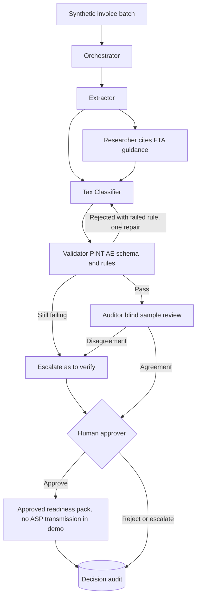
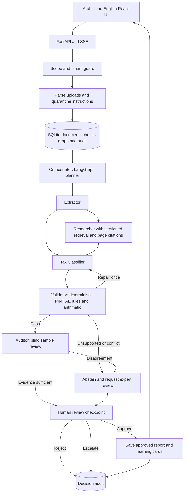

# A: UAE Tax and eInvoicing Readiness Agent Team

Project brief. Research checked on 7 November 2026, Asia/Dubai (UTC+4). Status: planning only. No application has been built or deployed.

## Business problem and UAE context

UAE finance teams need to translate changing tax guidance and structured invoice requirements into an evidence backed readiness plan. A PDF invoice is not an eInvoice under the MoF definition: the required invoice is structured data exchanged electronically and reported to the FTA [T1]. A document chatbot alone cannot establish readiness.

The MoF originally announced B2B and B2G scope subject to exclusions, an OpenPeppol based system, and a pilot starting 1 July 2026 [T2]. The original July 2026 ASP appointment deadline for the larger revenue cohort was subsequently extended to 30 October 2026 [T3]. The FTA's 25 October 2026 notice specifies AED 50 million and above: appoint an Accredited Service Provider by 30 October 2026 and implement by 1 January 2027. Below AED 50 million, the notice specifies appointment by 31 March 2027 and implementation by 1 July 2027 [T4]. The larger cohort's appointment date is therefore already past on this brief's research date.

Do not hardcode the old July appointment deadline. The MoF amendment announcement says “exceed” AED 50 million while the FTA notice says “equal or exceed”. The boundary rule and all exclusions must be checked against the operative amended decisions before production. Mark unresolved cases “to verify” and escalate. The MoF portal lists further 2026 amendments, so these summaries are a source inventory, not a complete legal interpretation [T1].

Corporate tax is a separate regime. The general FTA guide describes 0% on taxable income up to AED 375,000 and 9% on the portion above that amount, with separate treatment for Qualifying Free Zone Persons [T5]. Revenue for eInvoicing scheduling is not corporate taxable income. The demo must explicitly prevent that confusion. Free zone treatment, exemptions, groups, reliefs and multinational minimum tax are outside MVP and require specialist review.

## Why this needs a team of agents

This is the recommended primary demo for the DataRobot interview.

A single tool calling agent with a document chatbot would technically count as agentic, but it cannot safely judge a whole invoice batch on its own. The work naturally splits into roles that must check each other: extracting fields, classifying tax treatment, finding the governing guidance, validating structure against the PINT AE specification, and auditing the classifier's judgement independently. When one model does all of these, its own errors go unchallenged. A team makes every handoff visible, lets independent specialists run in parallel per invoice, and gives a human approver a clear gate before anything is sent to an Accredited Service Provider (ASP).

The design extends the Planner, Operator and Checker pattern already used in Hermes and in the DataRobot Demo: the Orchestrator plans, the specialists operate, and the Validator and Auditor are the checkers.

## Agent team

| Agent | Role | Inputs | Outputs | Tools |
|---|---|---|---|---|
| Orchestrator | Splits the invoice batch, assigns work, tracks progress and retry budget | Uploaded batch, tenant profile, research date | Per invoice work items, run state, SSE progress events | LangGraph state, task queue, audit log |
| Extractor | Reads PDFs and ERP exports into structured invoice fields | Synthetic PDF, JSON or CSV export | Structured invoice record with field level source references | PDF parser, JSON and CSV parsers, upload quarantine |
| Tax Classifier | Decides VAT and corporate tax treatment for each line | Structured invoice, tenant profile | Proposed treatment per line with reasoning and confidence | Reviewer approved rule set, deterministic arithmetic |
| Researcher | Retrieves and cites the FTA and MoF guidance behind each decision | Classifier questions, source register | Cited passages with source version and page | Versioned retrieval over the official source register |
| Validator | Checks each invoice against the frozen PINT AE field specification and business rules | Structured invoice plus proposed treatment | Pass, or rejection with the failed rule, returned to the Tax Classifier | Deterministic schema and rule checks, totals arithmetic |
| Auditor | Blind reviews a sample of the Classifier's calls without seeing its reasoning | Sampled invoices and cited sources only | Agree or disagree per sampled call, disagreements escalated | Independent model call, same retrieval, sampling policy |
| Human approver | Accountant who signs off the readiness pack | Validated batch, audit results, open questions | Approve, reject or escalate, recorded in the audit trail | Approval UI |

### Orchestration flow and handoffs

1. The Orchestrator splits the batch and sends each invoice to the Extractor.
2. The Tax Classifier and the Researcher work in parallel on each extracted invoice. The Classifier proposes a treatment and the Researcher attaches the governing citation.
3. The Validator checks the result. A failing invoice goes back to the Tax Classifier with the failed rule. Repair is bounded to one attempt, after which the invoice is marked "to verify" and escalated.
4. The Auditor blind samples Classifier decisions. Any disagreement is escalated rather than silently resolved.
5. The Human approver sees the batch summary, every rejection and every disagreement, and decides. Nothing is transmitted to an ASP in the demo, and nothing leaves the system without approval.

### Scripted demo moment: one agent catches another

A seeded synthetic invoice has a missing buyer identifier and line totals that do not reconcile. The Tax Classifier proposes a treatment anyway. The Validator rejects the invoice against the PINT AE specification, names the failed rule, and returns it to the Classifier. The Classifier cannot fix a missing identifier, so after one repair attempt the invoice is escalated as "to verify". Separately, the Auditor blind samples Classifier calls and disagrees with one seeded edge case, which also goes to the human approver. The audience sees each rejection and disagreement in the live SSE trace.

### Rubric mapping

| Criterion | How the team design addresses it |
|---|---|
| Problem Solving Acumen | Real compliance problem with dated FTA deadlines, decomposed into roles that each own one risk |
| Strategic Vision | Enterprise compliance use case of the kind DataRobot sells into, with a path to more entities and approved validators |
| Technical Credibility | Functional multi agent workflow, deterministic Validator, independent Auditor, bounded repair, human gate and audit trail |
| Creativity and Passion | Visible moment where one agent catches another's mistake, plus Arabic and English cited explanations |

## Target users and value

Primary users are controllers and finance managers at UAE mainland trading or professional services businesses. Accountants approve conclusions. A consulting firm could use the same workflow across isolated customer workspaces.

The output is a traceable readiness pack: applicable source versions, missing invoice data, unresolved questions, recommended tasks and named approval status. Value hypotheses are fewer omitted checks and less time assembling evidence, not automatic compliance or guaranteed tax savings.

## Live demo storyline: 6 minutes

1. Minute 0 to 1: open the fictional tenant Desert Ledger Trading. Show its synthetic company profile, stated revenue and research date. Explain that no real tax registration number is used, and introduce the agent team on screen.
2. Minute 1 to 2: upload a small synthetic invoice batch (PDF, structured JSON and a contract). The Orchestrator splits the batch and the Extractor produces structured records. The SSE trace shows each agent picking up work.
3. Minute 2 to 3: the Tax Classifier and Researcher run in parallel. The Validator rejects the seeded invoice with a missing buyer identifier and inconsistent totals, returns it to the Classifier, and escalates it after one repair attempt. Explain that a PDF alone is not an eInvoice and that required fields reference a frozen official specification.
4. Minute 3 to 4: ask in Arabic why an AED 375,000 threshold does not set the eInvoicing phase. The Researcher displays a cited Arabic explanation with the original English evidence.
5. Minute 4 to 5: the Auditor blind samples Classifier calls and disagrees on a seeded free zone or conflicting revenue case. The team refuses a final conclusion and escalates instead of guessing. Show an old deadline being rejected in favour of a newer source.
6. Minute 5 to 6: the accountant reviews the rejections and disagreements and approves a bounded readiness report, not a return or invoice transmission. Create three cited learning cards and a short quiz for the accounts team.

## MVP versus later

MVP covers one synthetic mainland legal entity, English and Arabic cited Q&A, PDF and JSON ingestion, a small reviewer approved rule set, arithmetic checks, phase guidance, missing evidence detection, readiness report and approval audit. Corporate tax coverage is educational orientation only, with a deterministic ordinary rate example under explicit assumptions.

Later add approved structured format validators, ERP connectors, broader entity classifications, source update alerts, accountant work queues and optional audio learning summaries. A real ASP integration requires an accredited provider and a separate implementation project. No filing, EmaraTax submission, invoice reporting, payments or production accounting changes are in scope.

## Synthetic data plan

Create a company profile, two contracts, six invoice pairs and a reviewer answer key. Seed missing fields, duplicate invoice IDs, rounding errors, contradictory revenue and outdated dates. Use labels such as SYNTHETIC_TRN_NOT_VALID rather than plausible real identifiers. Public official guidance remains in a separately versioned reference corpus. A manifest records author, source version, expected findings and SHA256 for every fixture.

## Evals and success metrics

Proposed acceptance targets, not achieved results: all 20 seeded arithmetic and required field tests pass; all 10 unsupported advice cases abstain or escalate; all 10 cross tenant attempts are blocked; every regulatory claim in the golden set has an entailing source and version. Include threshold boundary tests just below, equal to and above AED 50 million, and a stale deadline regression.

Have an accountant judge applicability and five Arabic answers independently. Target at least 90% expert acceptance on a fixed 30 question synthetic set before rehearsal. Measure actual response latency, tool errors, token usage, source freshness and human review minutes. Report sample size and failures, not a fabricated readiness percentage. Quiz scores measure training answers, not legal compliance.

## Tax specific risks

An incomplete invoice cannot establish tax liability. Never derive corporate taxable income from a single invoice, assume an exemption, certify ASP readiness, or expose a raw TRN in logs. Separate explicit customer assertions from verified facts. Missing field rules and effective dates remain “to verify” until tied to the current official specification and approved by the accountant.

## Official tax source register

[T1] MoF eInvoicing portal, definition, mandatory field requirements and amended decision inventory: https://mof.gov.ae/en/about-us/initiatives/einvoicing/

[T2] MoF initial scope and phased timelines, retained as historical context only: https://mof.gov.ae/en/news/ministry-of-finance-announces-the-issuance-of-two-ministerial-decisions-on-the-scope-of-obligations-and-the-timelines-for-implementing-the-electronic-invoicing-system-2/

[T3] MoF targeted amendments and extension: https://mof.gov.ae/en/news/ministry-of-finance-announces-targeted-amendments-to-einvoicing-system-decisions/

[T4] FTA notice dated 25 October 2026, current deadline summary used above: https://tax.gov.ae/en/media.centre/news/federal.tax.authority.calls.on.persons.subject.to.einvoicing.to.comply.wit.the.prescribed.legal.deadlines.and.avoid.administrative.penalties.aspx

[T5] FTA Corporate Tax General Guide, ordinary rates and free zone distinctions; current applicability to any real entity is to verify: https://tax.gov.ae/Datafolder/Files/Guides/CT/CT%20General%20Guide%20-%20EN%20-%2010%2009%202023.pdf

## Architecture and implementation

This is a proposed application, not a working product yet. Build code first with a FastAPI backend, React and Vite frontend, and a LangGraph workflow. Use SSE to expose actual agent progress. Every run carries a tenant ID, source versions, tool results, approval state and an audit trail.

Each agent is a LangGraph node with its own prompt, allowed tools and output schema. The Orchestrator is the planner, the Extractor, Tax Classifier and Researcher are operators, and the Validator and Auditor are checkers.

The checker must validate source entailment, not merely the presence of a citation. A second model alone is not proof. Numeric comparisons and required field checks run as deterministic code. Bound repair to one attempt, then abstain. Uploads are untrusted data and cannot grant tools or override system instructions. Approval requires a completed run whose checker passed and whose document version has not changed. Reject cross tenant access before retrieval.

Use OmniRoute chat completions at `http://127.0.0.1:20128/v1`, with `gh/gpt-5.6-terra` as the primary model and `gh/gpt-5.6-luna` as a controlled fallback. Record the actual selected model and retry reason. `ollama/qwen3-coder:30b` is a local option whose Arabic and domain quality must be evaluated. Routing locally does not establish where an upstream provider processes data. Do not change Hermes or OmniRoute configuration.

### Reuse from DataRobot Demo

Read `/home/abdul/projects/DataRobot-Demo` only as a reference. Reuse its patterns for FastAPI, SSE, LangGraph planner/operator/checker, SQLite GraphRAG, approval decisions, evals and Docker Compose in these new projects after explicit build approval. The existing README confirms these components and its security tooling. Keep ports and storage separate. Optional LightRAG on Ollama comes later only if retrieval evals justify it.

Reuse Gitleaks, TruffleHog, Trivy and Semgrep for this project's own code and containers. Secret verification stays off. Prowler requires separate opt in and approved credentials. Do not copy old security findings into business data or inherit old simulated metrics. `/home/abdul/projects/DataRobot-V2` and its OpenRig builder/reviewer team can support implementation later. No agents have been assigned by this brief.

### Application contract

Proposed routes are `POST /api/documents`, `POST /api/runs`, `GET /api/runs/{id}/events`, `POST /api/runs/{id}/decisions`, and `GET /api/reports/{id}`. Store tenant, document hash, page, source URL, retrieval date, effective date, rule version, model, checker outcome and approval actor. Cite document IDs and exact pages or sections in the UI. Unknown dates display “to verify”. Arabic uses RTL layout with explicit LTR treatment for amounts and identifiers.

## Privacy, security and legal controls

Use only synthetic business documents with visibly fake identifiers. No real client records, PII, credentials, bank details or production documents. Public regulatory material is reference evidence, not a synthetic customer document. Store approved extracts with provenance and respect source terms. Do not scrape authenticated services.

This is an assistant for qualified human review, not tax, legal, investment or regulatory advice. Never label a business or transaction compliant just because a checklist passes. Display missing evidence and scope limitations prominently.

The UAE PDPL governs personal data processing and includes conditions for transfers abroad [P1, P2]. It is not a blanket rule that all data must stay in the UAE. For a production customer, map applicable federal, sector and free zone obligations with counsel. Select UAE hosted storage, inference, backups and logs where required by policy or law. Verify every provider's actual processing location and retention terms. A localhost OmniRoute URL does not guarantee UAE residency. Until that verification, permit only synthetic content to remote models. Design access controls, encryption, retention, deletion, audit access and incident handling before accepting real data.

## DataRobot productization vision

Position this as a repeatable customer solution with a reusable agent core and versioned jurisdiction packs. A DataRobot customer could evaluate model choices, monitor agent quality and latency, govern releases and connect an approved agent service to its enterprise applications. Confirm the customer's DataRobot edition, supported integrations and UAE deployment options before promising features or residency.

Move from SQLite to managed production storage only when scale and tenancy requirements justify it. Add SSO, scoped roles, isolated retrieval, customer managed source approvals, model regression gates, observability and policy version rollback. Charge against validated workflow value rather than promising generic productivity gains. Start with a supervised pilot, measure baseline review effort, then compare expert accepted output and total review time. No claimed savings are measured yet.

## Interview delivery

Allocate the 15 minute presentation as follows: problem and customer value 2 minutes, architecture and tools 3 minutes, live demo 6 minutes, challenges and learnings 2 minutes, and product vision 2 minutes. Demonstrate a refusal or escalation as well as a successful case. Keep a clearly labelled synthetic replay ready if model access fails, and do not present replay timings as live measurements.

## Next steps

1. Confirm this brief and the narrow MVP before coding.
2. Freeze official source versions and have the domain reviewer approve rule interpretations.
3. Author synthetic fixtures and expected results before implementing the graph.
4. Build one complete vertical slice with frontend, backend, citations and approval.
5. Add Arabic review, adversarial evals and container restart persistence checks.
6. Run a timed rehearsal and disclose remaining limitations.

## Shared official privacy sources

[P1] UAE government, Data protection laws: https://u.ae/en/about-the-uae/digital-uae/data/data-protection-laws

[P2] Federal Decree by Law No. 45 of 2021, especially Articles 22 and 23: https://uaelegislation.gov.ae/en/legislations/1972/download
